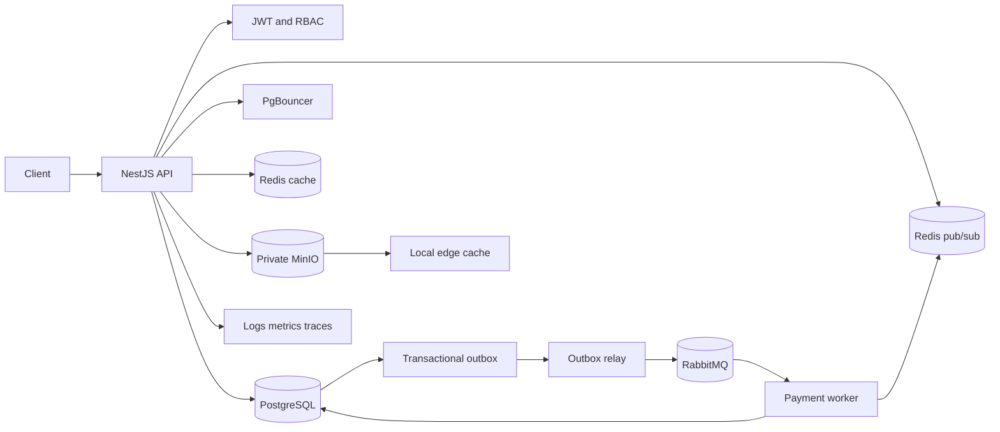

# NestJS Marketplace course project

This is the final Marketplace API submission on branch course-project. It implements an authenticated marketplace in which sellers publish products, buyers create orders, PostgreSQL reserves inventory transactionally, a simulated payment provider is processed asynchronously, and paid status is delivered through the outbox, RabbitMQ, workers, Redis, Socket.IO, and SSE.

The project is local-first. Docker Compose runs PostgreSQL, PgBouncer, RabbitMQ, Redis cache, Redis queue, MinIO, the API, an outbox relay, and a payment worker. AWS infrastructure is retained only as previous homework evidence and is not provisioned by final verification.

## A. Project overview

Main business scenario:

1. Login produces an RS256 access token and refresh token.
2. An authenticated buyer submits an order with an Idempotency-Key.
3. One PostgreSQL transaction reserves stock and writes the order plus outbox event.
4. The outbox relay publishes with RabbitMQ publisher confirms.
5. The payment worker applies the simulated payment exactly once.
6. The API observes the status event through Redis pub/sub and exposes it through Socket.IO and authenticated SSE.

Scope limitations: payment is simulated; MinIO stands in for S3; SSE replay is a bounded in-memory buffer; deployment evidence is local kind/Pulumi plus previous CI/AWS homework evidence.

## B. Domain validation

The original HW0 template was not present in the repository or reachable Git history during final preparation. This is therefore a repository-derived table, not a claim to reproduce the missing template.

| Concern | Marketplace property | Applicable | Implementation/evidence |
|---|---|---:|---|
| Identity | Login is required for checkout and protected reads | Yes | src/auth and AuthGuard |
| Authorization | Owner and role checks control resources | Yes | roles.guard.ts and orders controller |
| Inventory | Concurrent checkout cannot oversell | Yes | orders service; 20 successes/30 rejections |
| Money | Frozen order amount is validated by webhook | Yes | payment service and E2E |
| Idempotency | Replay returns the original order | Yes | checkout and Compose smoke |
| Async processing | Outbox, queue, retries, DLQ and worker | Yes | src/outbox, src/rabbitmq, src/payments |
| File delivery | Private presigned upload, multipart and edge cache | Yes | src/files and src/cdn |

At least six applicable properties are implemented and demonstrated; unsupported production guarantees are not claimed.

## C. Architecture

Checkout sequence: buyer -> API -> PostgreSQL transaction -> outbox relay -> RabbitMQ -> payment worker -> PostgreSQL payment deduplication -> Redis event -> API realtime channels.

Order lifecycle is created -> paid -> shipped -> completed. Cancellation is a protected created -> cancelled transition that restores inventory.

Controllers validate transport input and authorization. Services own business transitions and transactions. Repositories/data-access classes own SQL. The outbox and worker are separate processes so commit, publication, acknowledgement, and payment effect are independently observable.

## D. Architectural trade-offs

- Selected PostgreSQL row locking because inventory correctness is the core invariant; a distributed inventory service would add an operational consistency boundary.
- Selected a transactional outbox because direct publication inside checkout could lose events; the cost is relay and duplicate-delivery handling.
- Selected RabbitMQ durable queues and manual acknowledgement because payment must survive process failure; the cost is broker operations.
- Selected Redis for cache, sessions, rate limits, and notifications because those are low-latency concerns; Redis is not the system of record.
- Selected MinIO and presigned URLs because file bytes bypass the API; production could use S3 at cloud cost.
- Selected bounded in-memory SSE replay because the course permits it; durable long-term replay would require event storage.

## E. Architecture decision log

Git history shows the project evolving from schema/repositories, to query optimization and concurrency, to transactional checkout, outbox/payment processing, JWT/RBAC, realtime, file storage, Compose, and CI/evidence gates. Relevant commits include 00f6fdf, 337b97d, d59ad72, 68527f5, da99c96, b271718, and bff3413. This records repository evidence and does not invent undocumented historical decisions.

## F. Local startup

Prerequisites: Node.js 22+, npm, Docker Desktop, and OpenSSL.

    npm ci
    bash scripts/init-local-compose-secrets.sh .env.compose.local
    docker compose --env-file .env.compose.local up -d --build
    curl -fsS http://127.0.0.1:3300/healthz
    curl -fsS http://127.0.0.1:3300/readyz
    node scripts/compose-smoke.mjs

Host API port is 3300 and container port is 3000. API_PORT, MINIO_API_PORT, MINIO_CONSOLE_PORT, and PACT_PORT are configurable. The smoke test logs in, creates an order, waits for paid, retrieves it independently, and verifies idempotent replay.

Stop safely with:

    docker compose --env-file .env.compose.local stop

Do not use down -v for grading. Demo credentials default to anna@example.com and Password123!, and can be overridden with DEMO_EMAIL and DEMO_PASSWORD. Troubleshoot with docker compose ps and docker compose logs service; do not print secret files.

## G. API documentation

Complete contract: [openapi/openapi.yaml](openapi/openapi.yaml).

Main routes are POST /auth/login, POST /auth/refresh, POST /auth/logout, GET/POST /products, POST/GET /orders, GET /orders/:id, PATCH /orders/:id/status, GET /orders/:id/events, POST /payments/webhook, POST /uploads/intent, POST /uploads/commit, /healthz, /readyz, and /metrics.

Orders require Bearer JWT and Idempotency-Key. Pagination is bounded cursor pagination. Webhooks require HMAC signature and frozen amount validation. Failures use application/problem+json.

## H. Configuration and secrets

| Variable | Required | Process | Purpose/source |
|---|---:|---|---|
| PORT | No | API | HTTP port |
| DB_URL or DB_HOST/PORT/USER/PASSWORD/NAME | Yes | API/workers | PostgreSQL |
| DB_PASSWORD_FILE | Local option | scripts | Secret-file path |
| JWT_KID, JWT_PRIVATE_KEY, JWT_PUBLIC_KEY | Yes | API | Generated local RS256 keys |
| REFRESH_TOKEN_PEPPER | Yes | API | Refresh hashing pepper |
| BROKER_URL | Yes | relay/worker | RabbitMQ |
| REDIS_URL, REDIS_QUEUE_URL | Yes | API/worker | Cache/pub-sub and queue |
| PAYMENT_WEBHOOK_SECRET | Yes | API/worker | Webhook HMAC |
| STORAGE_* | File demos | API/demo | Private MinIO/S3-compatible storage |

.env, .env.compose.local, .npm_token, and secrets are ignored. scripts/init-local-compose-secrets.sh generates local keys; rotate.sh is the available rotation procedure. Production credentials were not rotated.

## I. Database, performance, backup, and cache

Migrations are in src/migrations. Initialization and seed are idempotent. Inventory reservation and outbox creation share one transaction.

Measured evidence: EXPLAIN ANALYZE BUFFERS used an index scan, touched 3 shared buffers, and executed in 0.112 ms. demo:nplus1 measured 14 to 1 queries at N=5 and 25 to 1 at N=10; optimized query count stayed at 1. PgBouncer SHOW CONFIG reported pool_mode=transaction.

RESTORE-DRILL.md records the fresh backup and isolated restore. Backup marketplace_2026-11-25_15-24-54.dump restored with source/restored checksum 32|8880400, size 48K, RTO 6 seconds, and exit 0. Backups are daily, so documented RPO is up to 24 hours. Existing backups were preserved.

Redis separates cache and queue services: cache uses allkeys-lru; queue uses append-only storage and noeviction. The session demo reported requests=3, sessions=1, in-redis=1, ttl-renewed=1.

## J. Security

JWT verification allows RS256 only, validates claims, and bounds access/refresh lifetimes. Logout deny-lists access tokens and revokes refresh tokens. Refresh reuse revokes the family. Ownership and role checks distinguish 401 from 403. Webhooks use HMAC and frozen amounts. Rate limiting returns 429 with Retry-After.

| OWASP Top 10:2025 concern | Actual applicability/source |
|---|---|
| Broken access control | AuthGuard, roles.guard.ts, order/file ownership |
| Security misconfiguration | env.schema.ts, readiness, non-root image |
| Supply-chain failures | lockfile, npm ci, BuildKit secret, Trivy |
| Cryptographic failures | RS256, HMAC, hashed refresh tokens |
| Injection | parameterized SQL and Zod |
| Authentication failures | refresh rotation, denylist, bounded TTL |
| Logging/alerting failures | redaction, request context, metrics/traces |

Final Trivy evidence found 9 HIGH/CRITICAL findings under the configured limit of 10. No audit force-fix or broad dependency upgrade was performed.

## K. Testing

    npm run build
    npm run typecheck
    npm run lint
    npm run architecture
    npm run check:env
    npm run test:unit
    npm run test:integration
    npm run test:e2e
    npm run test:contract
    npm run verify:provider
    git diff --check

Recorded counts: integration 3 suites and 7 tests passed; E2E 1 suite and 9 tests passed, including the 50-request concurrency test. Unit and Pact commands exited 0 but emitted no Jest count summary in the local environment. Testcontainers requires Docker Desktop.

## L. Observability

/healthz is liveness and /readyz is readiness. Structured logs use request context and redact credentials. /metrics exposes bounded RED labels. OpenTelemetry and Grafana configuration are under src/observability and observability.

The realtime runbook command is:

    BASE_URL=http://localhost:3300 node scripts/realtime-demo.mjs

The final result reported paid status, ownerJoin=true, foreignJoinRejected=true, invalidJwtRejected=true, ownerReceived=true, foreignReceived=0, and sseReplayObserved=true.

## M. Docker, deployment, and CI/CD

The production image is multi-stage, uses BuildKit npm-token secrets, contains production dependencies and compiled output only, runs as UID 65532, and uses a distroless shell-free runtime. Image build and the configured Trivy gate passed.

Kubernetes/Pulumi files are under infra, k8s, and scripts. Existing HW31 AWS teardown and HW32 CI/kind evidence remain under evidence and .github/workflows. Those are explicitly previous homework/CI runs; the final local Compose smoke was run against rebuilt containers.

## Reviewer runbook

1. Clone and checkout course-project.
2. Run npm ci.
3. Generate .env.compose.local with scripts/init-local-compose-secrets.sh.
4. Start Compose with docker compose --env-file .env.compose.local up -d --build.
5. Run node scripts/compose-smoke.mjs.
6. Run npm run verify:compose-concurrency.
7. Run the regression commands in Testing.
8. Run the realtime command in Observability.
9. Run the restore drill using the local database environment.
10. Inspect evidence, RESTORE-DRILL.md, OpenAPI, observability, and CI files.

## N. Grading

Detailed sanitized evidence: [evidence/phase6.2-verification.md](evidence/phase6.2-verification.md).

| Criterion | Implementation/course path | Exact verification and invariant | Status |
|---|---|---|---|
| 11.1 | JWT, RBAC, authenticated API | demo:auth, demo:reuse, demo:rbac; 401/403 and family revocation | PARTIAL |
| 11.2 | Checkout, reservation, rollback, idempotency | test:e2e and compose-smoke; paid and same replay ID | VERIFIED |
| 11.3 | Optimization, N+1, indexes, PgBouncer | demo:nplus1, EXPLAIN, SHOW CONFIG | VERIFIED |
| 11.4 | Outbox, RabbitMQ, workers, retry/DLQ | demo:outbox/publish/retry/dlq and Compose smoke | PARTIAL; live payment verified |
| 11.5 | Redis, storage/CDN, realtime | demo:session, rate limit, upload demos, realtime-demo | PARTIAL; session/realtime verified |
| 11.6 | Docker, deployment, CI/CD, observability | image build, scan, workflows, observability demos | PARTIAL |
| 11.7 | Reproducible documentation/evidence | this README, RESTORE-DRILL.md, evidence | VERIFIED |

Current integer estimate: 92/95. This is evidence-based and is not a guaranteed examiner grade.

## O. Known limitations

- The original HW0 template was unavailable; the validation table is labeled repository-derived.
- SSE replay is bounded in memory and not durable across API restart.
- RPO is up to 24 hours under the daily backup policy.
- Nine HIGH/CRITICAL scanner findings remain under the configured gate.
- Some existing demos perform cleanup against selected data/cache resources and were not run against shared development state.
- No grade is guaranteed.
