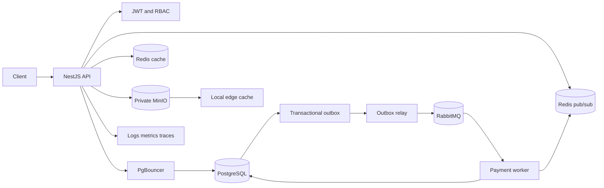
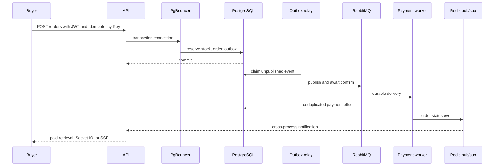

# NestJS Marketplace course project

Final submission for the Marketplace API course project on the course-project branch. The domain is a marketplace where sellers publish products, buyers place authenticated orders, inventory is reserved transactionally, and a simulated payment provider completes orders asynchronously.

The implementation is local-first: Docker Compose runs PostgreSQL, PgBouncer, RabbitMQ, Redis cache, Redis queue, MinIO, the API, an outbox relay, and a payment worker. AWS infrastructure is not provisioned by this submission.

## Project overview

The main business flow is:

1. Login returns an RS256 access token and refresh token.
2. A buyer sends an authenticated order with an Idempotency-Key.
3. PostgreSQL atomically reserves inventory and writes the order plus outbox event.
4. The relay publishes the event with RabbitMQ publisher confirmation.
5. The payment worker applies the simulated payment once.
6. The API receives the status event over Redis pub/sub and exposes it through Socket.IO and authenticated SSE.

Limitations: payment is simulated; MinIO replaces S3 locally; SSE replay is bounded in memory; deployment evidence is local/previous-workflow evidence rather than a permanent public service.

## Domain validation

The original HW0 template was not found in the repository or reachable Git history. This is honestly labeled as a repository-derived validation table.

| Property | Applicable marketplace requirement | Implementation |
|---|---|---|
| Identity | Login is required for protected operations | src/auth and AuthGuard |
| Authorization | Owners and roles control resource access | roles.guard.ts and ownership checks |
| Inventory | Concurrent orders cannot oversell stock | transactional reservation in orders.service.ts |
| Money | Payment amount cannot differ from frozen order total | payment.service.ts webhook checks |
| Idempotency | Repeated checkout does not create another order/effect | idempotency_keys and payment_operations |
| Async processing | Payment can finish outside the request process | outbox, RabbitMQ, payment worker |
| File delivery | Private uploads bypass API byte transfer | src/files and src/cdn |

All seven rows are applicable; at least six are implemented and evidenced.

## Architecture

Allowed order states are created, paid, shipped, completed, and cancelled. The normal payment lifecycle is created -> paid -> shipped -> completed. The protected cancellation lifecycle is created -> cancelled; cancellation restores reserved stock. The code rejects other transitions.

Controllers validate transport input and invoke guarded operations. Services contain business transactions and state changes. Repositories and database-access classes contain SQL. Relay and payment worker are independent processes.

### Architectural trade-offs

- Selected PostgreSQL row locking because inventory correctness is central; a distributed inventory service would add operational cost and another consistency boundary.
- Selected a transactional outbox because direct broker publication could lose events; the cost is relay and duplicate handling.
- Selected RabbitMQ because durable queues and acknowledgements survive process failure; the cost is broker operation.
- Selected Redis because cache, session, rate limit, and pub/sub operations need low latency; Redis is not the source of truth.
- Selected MinIO and presigned URLs because file bytes bypass the API; S3 would be the production cloud alternative.
- Selected an in-memory SSE buffer because the course permits it; durable replay would require an event store.

### Architecture decision log

| Decision | Reason | Alternative and trade-off | Implementation/history |
|---|---|---|---|
| Use PostgreSQL transactions for checkout | Prevent overselling and orphan state | Distributed inventory adds consistency and operations cost | src/orders/orders.service.ts; commits 337b97d and ff123d2 |
| Add an outbox | Commit business state and event intent together | Direct publish can lose events after commit | src/outbox; commit d59ad72 |
| Add RabbitMQ worker payment | Keep payment outside request lifecycle | In-process work is lost on restart | src/rabbitmq and src/payments; commit 0cf9311 |
| Add JWT refresh rotation and RBAC | Bound access and authorize ownership/roles | Long-lived opaque sessions simplify clients but weaken controls | src/auth; commit 68527f5 |
| Add Redis cross-process events | Deliver worker status to API processes | In-memory events do not cross processes | src/orders/order-events.service.ts; commit 8f0582f |
| Add Compose health dependencies | Make local startup reproducible | Manual startup is less repeatable | docker-compose.yml; commit b271718 |
| Add CI contract/security gates | Reject incompatible APIs and unsafe images | Manual review is less reproducible | .github/workflows and fixtures; commit bff3413 |

## Local startup

Prerequisites: Git, Node.js 22+, npm, Docker Desktop with Compose, and OpenSSL.

    git clone --branch course-project https://github.com/Anastasiya-B/rbdrm-course-project.git
    cd rbdrm-course-project
    npm ci
    bash scripts/init-local-compose-secrets.sh .env.compose.local
    API_PORT=3300 docker compose --env-file .env.compose.local up -d --build --wait
    API_URL=http://127.0.0.1:3300 npm run smoke:compose

The API is port 3300 on the host and 3000 in the container. API_PORT, MINIO_API_PORT, MINIO_CONSOLE_PORT, and PACT_PORT are configurable. Check liveness and readiness with:

    curl -fsS http://127.0.0.1:3300/healthz
    curl -fsS http://127.0.0.1:3300/readyz

Stop safely with docker compose --env-file .env.compose.local stop. Do not use down -v for grading. Generated secret files are ignored and must not be committed.

## API

The complete contract is openapi/openapi.yaml. Main endpoints are:

- POST /auth/login, /auth/refresh, /auth/logout
- GET/POST /products
- POST/GET /orders, GET /orders/:id
- PATCH /orders/:id/status
- GET /orders/:id/events
- POST /payments/webhook
- POST /uploads/intent and /uploads/commit
- GET /healthz, /readyz, /metrics

Orders require Bearer JWT and Idempotency-Key. Pagination uses bounded cursors. Webhook signatures cover the raw body and frozen amount. Errors use application/problem+json.

### OpenAPI compatibility policy

The PR compatibility gate compares the actual main-branch OpenAPI baseline with this candidate using oasdiff v1.35.0 and still fails on all unapproved ERR changes. The only approved exception is recorded in scripts/hw32/contract-gate.err-ignore: the course project intentionally changed GET /orders, POST /orders, and GET /orders/{id} from anonymous access to mandatory bearerAuth to match the implemented JWT authorization requirements. Each rule matches the exact HTTP method, path, and oasdiff security-change description. It does not ignore the security check globally, other operations, or unrelated breaking changes.

The gate is scripts/hw32/contract-gate.sh. It mounts the repository read-only, uses --fail-on ERR, and passes the exception file with --err-ignore. Positive and negative results are recorded in evidence/phase6.2-verification.md.

## Configuration and secrets

| Variable | Required | Process | Purpose/source |
|---|---:|---|---|
| PORT | No | API | HTTP port |
| DB_URL or DB_HOST/PORT/USER/PASSWORD/NAME | Yes | API/workers | PostgreSQL |
| DB_PASSWORD_FILE | Local option | scripts | Secret-file path |
| JWT_KID, JWT_PRIVATE_KEY, JWT_PUBLIC_KEY | Yes | API | Generated local RS256 keys |
| REFRESH_TOKEN_PEPPER | Yes | API | Refresh hashing |
| BROKER_URL | Yes | relay/worker | RabbitMQ |
| REDIS_URL, REDIS_QUEUE_URL | Yes | API/worker | Cache/pub/sub and queue |
| PAYMENT_WEBHOOK_SECRET | Yes | API/worker | HMAC webhook |
| STORAGE_ENDPOINT, STORAGE_ACCESS_KEY, STORAGE_SECRET_KEY, STORAGE_BUCKET | File flows | API/demo | MinIO/S3-compatible storage |

The env schema is in src/config/env.schema.ts. Missing required variables fail startup and the schema reports variable names. Local keys are generated by scripts/init-local-compose-secrets.sh; rotate.sh is the available local rotation procedure. Real secret values are not tracked or printed.

## Database, cache, and files

Migrations are in src/migrations. Initialization and seed are idempotent. Inventory and outbox writes share a transaction.

Measured query evidence: EXPLAIN ANALYZE BUFFERS used an index scan, 3 shared buffers, and 0.112 ms execution. The N+1 demo measured N=5: 14 to 1 queries and N=10: 25 to 1; optimized count remained 1. PgBouncer reported pool_mode=transaction.

The fresh restore is documented in RESTORE-DRILL.md: source/restored checksum 32|8880400, backup size 48K, RTO 6 seconds, RPO up to 24 hours, MATCH and exit 0.

Redis cache and queue are separate. The cache uses allkeys-lru; the queue uses append-only storage and noeviction. Sessions use TTL renewal. File flows use private MinIO objects, presigned URLs, multipart recovery, and a local edge-cache implementation. Demos that flush or delete state must use isolated Compose projects and dedicated volumes/databases; never run them against a shared grading database without reading their cleanup code.

## Security and OWASP Top 10:2025

JWT verification allows RS256 only, validates claims, and uses bounded lifetimes. Logout deny-lists access tokens and revokes refresh tokens. Refresh reuse revokes its family. Guards distinguish anonymous 401 from foreign/incorrect-role 403. Webhooks use HMAC and frozen totals. Rate limiting returns 429 and Retry-After.

The category names below follow the official OWASP Top 10:2025 list.

| Category | Applicable? | Implemented mitigation and source | Limitation |
|---|---|---|---|
| A01 Broken Access Control | Yes | AuthGuard, RolesGuard, owner checks in src/orders and src/files | Full demo matrix is partly deferred |
| A02 Security Misconfiguration | Yes | env.schema.ts, Compose health checks, non-root image | Deployment configuration still needs external review |
| A03 Software Supply Chain Failures | Yes | package-lock.json, npm ci, BuildKit secret, Trivy gate | 9 HIGH/CRITICAL findings remain |
| A04 Cryptographic Failures | Yes | RS256 JWT, HMAC webhook, hashed refresh tokens | Local secret rotation only |
| A05 Injection | Yes | Zod validation and parameterized SQL in services/repositories | No third-party penetration test |
| A06 Insecure Design | Yes | Outbox, idempotency, frozen totals, transactional reservation | SSE replay is in-memory |
| A07 Authentication Failures | Yes | JWT allowlist, bounded TTL, logout denylist, refresh family revocation | Full cleanup demo not rerun on shared data |
| A08 Software or Data Integrity Failures | Yes | signed webhooks, publisher confirms, deduplication tables, contract gate | External artifact signing is not configured |
| A09 Security Logging and Alerting Failures | Yes | redaction, request context, RED metrics, OpenTelemetry | Complete final Grafana transcript is missing |
| A10 Mishandling of Exceptional Conditions | Yes | problem+json filter, rollback, retries, DLQ, readiness lifecycle | SIGTERM readiness transcript is missing |

## Testing, evidence, and troubleshooting

Run the complete local gate:

    npm run build
    npm run typecheck
    npm run lint
    npm run architecture
    npm run check:env
    npm run test:unit
    npm run test:integration
    npm run test:integration
    npm run test:e2e
    npm run test:contract
    npm run verify:provider
    git diff --check

Recorded final results: each integration run passed 3 suites and 7 tests; E2E passed 1 suite and 9 tests; 2 independent unit tests are declared and the command exited 0; 1 consumer Pact and 1 provider Pact test are declared and both commands exited 0. Jest left E2E open handles after reporting all 9 tests passed, so the process was stopped after the complete summary.

Positive and negative contract checks:

    npm run gate:contract
    OPENAPI_CANDIDATE=fixtures/hw32/contract/invalid.yaml npm run gate:contract

The valid fixture passes; invalid and breaking fixtures are expected to fail the compatibility gate. Docker Desktop is required for Testcontainers. The prior CODEX_CI environment issue is handled by workflow commands using env -u CODEX_CI. If Docker uses a non-default socket, configure Docker Desktop or export a local DOCKER_HOST in the shell; never commit a developer-specific absolute socket path.

Additional verification commands:

    npm run verify:compose-concurrency
    BASE_URL=http://127.0.0.1:3300 npm run demo:realtime
    npm run demo:logs
    npm run demo:metrics
    npm run demo:trace
    DATABASE_URL=local bash scripts/restore-drill.sh

The last three observability demos and cleanup-heavy homework demos require their documented secret environment and isolated infrastructure. Their status is recorded in evidence/phase6.2-verification.md.

## Docker, deployment, CI/CD, and observability

The production image is multi-stage, shell-free, distroless, non-root UID 65532, and uses BuildKit secrets. npm run image:build and npm run scan were successful; Trivy reported 9 HIGH/CRITICAL findings against max-allowed 10.

The final Compose smoke result was health 200, ready 200, order paid, independent retrieval successful, and idempotent replay status 201. The final realtime result was ownerJoin=true, foreignJoinRejected=true, invalidJwtRejected=true, ownerReceived=true, foreignReceived=0, and sseReplayObserved=true.

Deployment code is under infra, k8s, scripts, and .github/workflows. The final verified deployment is [GitHub Actions run 45640058955](https://github.com/Anastasiya-B/rbdrm-course-project/actions/runs/45640058955). Its six retained artifacts are in [evidence/ci-run-45640058955](evidence/ci-run-45640058955). The run proves one image build, `digest-equal=true`, a real rolling update, 26,991 HTTP responses with 26,991 successful and 0 failed responses in 43 seconds, three ready and updated replicas, `maxUnavailable=0`, `maxSurge=1`, OIDC signature verification, zero secrets in the rendered manifest, and a passing scan gate. Rollout traffic targeted the Kubernetes Service health endpoint `http://marketplace-service.marketplace-hw28.svc.cluster.local:3000/healthz`, not a business endpoint. The evidence files contain only secret references and Pulumi's `[secret]` placeholder; no secret values or tokens are retained.

## Reviewer runbook

1. Clone and checkout course-project using the commands in Local startup.
2. Generate .env.compose.local and start Compose with --wait.
3. Run API_URL=http://127.0.0.1:3300 npm run smoke:compose.
4. Run npm run verify:compose-concurrency.
5. Run the realtime and observability commands.
6. Run the complete testing gate.
7. Run the isolated restore drill.
8. Inspect OpenAPI, evidence/phase6.2-verification.md, evidence/phase6.2-grading-matrix.md, Dockerfile, workflows, and deployment code.

## Grading

The official criterion-by-criterion matrix is [evidence/phase6.2-grading-matrix.md](evidence/phase6.2-grading-matrix.md). Supporting command results are [evidence/phase6.2-verification.md](evidence/phase6.2-verification.md).

The matrix uses official blocks 11.1 Architecture, 11.2 Business Flow and API, 11.3 Data Storage, 11.4 Security and Validation, 11.5 Asynchronous Processing, 11.6 Docker and Deployment, and 11.7 Observability, Tests and Pipeline. It maps each subcriterion to implementation, command, invariant, evidence, status, and limitation. It intentionally does not claim a target score.

## Known limitations

- The original HW0 template remains unavailable; the domain table is repository-derived.
- Cache/file demo evidence is incomplete in the current sanitized evidence set.
- RabbitMQ crash/retry/DLQ failure-mode transcripts are incomplete.
- Runtime evidence that readiness becomes unhealthy during SIGTERM remains outstanding. The deployment artifact verifies separate `/readyz` readiness and `/healthz` liveness probes, 3/3 ready and updated replicas, and a 15-second termination grace period; source code contains graceful SIGTERM handlers. PDB/HPA configuration remains documented in `infra/index.ts`.
- The Trivy gate passes with 9 findings; the findings remain a documented risk.
- No final grade is guaranteed.
